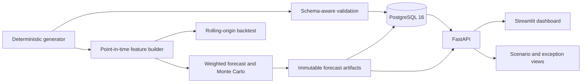
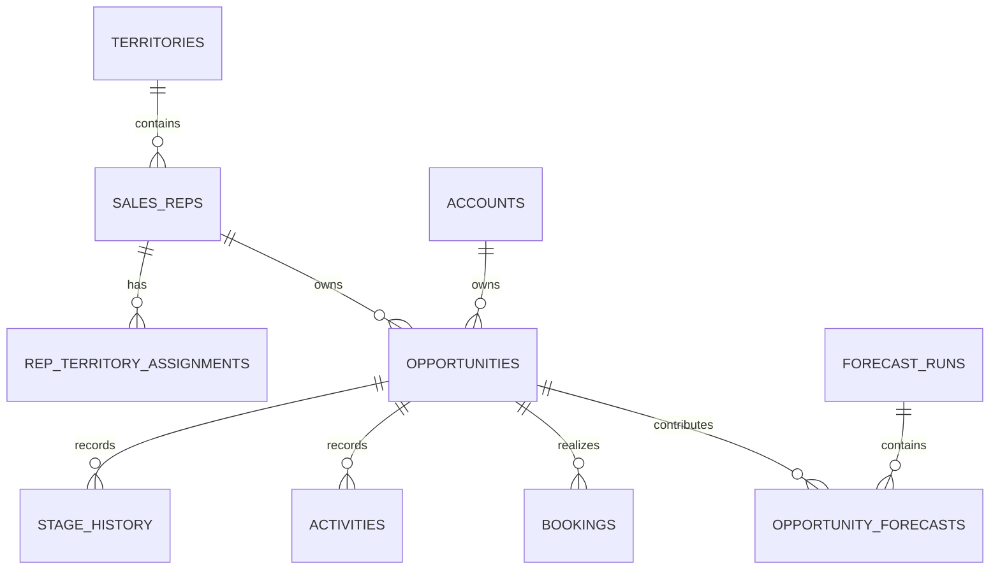

# Sales Forecasting & Pipeline Intelligence System (BUSS)

BUSS is a reproducible, local demonstration of auditable sales-pipeline intelligence. It generates a deterministic synthetic CRM dataset, loads it into PostgreSQL, produces point-in-time weighted-pipeline forecasts and scenario simulations, and presents results through FastAPI and a six-page Streamlit dashboard.

It is a portfolio project, not a production forecasting service. It has no authentication, shared-deployment controls, or real customer data.

## Business problem

Sales leaders need more than a headline forecast: they need to know which snapshot produced it, what information was available then, whether quota is at risk, which records need attention, and how assumptions affect the result. BUSS makes that lineage visible at opportunity level while separating a current forecast from historical backtesting.

## Capabilities

- Deterministic synthetic CRM generation with starter, anomalous, and FULL configurations.
- PostgreSQL schema, migrations, validation, and idempotent ingestion.
- Point-in-time feature construction with explicit leakage guards.
- Transparent weighted-pipeline forecasts and Monte Carlo P10/P50/P90 intervals.
- BASE, CONSERVATIVE, OPTIMISTIC, and persisted CUSTOM scenario assumptions.
- Rules-based risk, quota, concentration, and data-quality exceptions.
- Rolling-origin historical evaluation and immutable forecast-run lineage.
- FastAPI endpoints and six Streamlit pages: Executive Overview, Pipeline Explorer, Risk and Exceptions, Scenario Planner, Model Evaluation, and Audit and Traceability.

## Architecture





## Technology stack

Python 3.11, FastAPI, Pydantic, Uvicorn, PostgreSQL 16, Psycopg 3, Pandas, NumPy, Streamlit, Docker Compose, and pytest.

## Quick start

Prerequisites: Docker Desktop with Compose v2. The default ports are intentionally separate from the original BUSS stack: PostgreSQL `5545`, API `8011`, dashboard `8511`.

```powershell
Copy-Item .env.example .env
# Edit .env and set a local-only POSTGRES_PASSWORD.
docker compose up --build -d
docker compose ps
docker compose logs --no-color bootstrap
```

Open [API docs](http://localhost:8011/docs), [health](http://localhost:8011/health), and the [dashboard](http://localhost:8511). The one-shot bootstrap service creates a starter dataset, runs migrations, validates it, and ingests it idempotently before the API starts.

Stop services without deleting data:

```powershell
docker compose stop
```

This publication copy uses its own Compose project (`buss-publication`) and named volumes (`buss_publication_*`). It does not share the original BUSS volumes. Do not run `docker compose down -v` unless you intentionally want to delete this publication copy's local data.

### Optional isolated run

For an additional disposable publication-only volume pair, choose a suffix:

```powershell
$env:COMPOSE_VOLUME_SUFFIX = 'demo-20261028'
docker compose -f docker-compose.yml -f docker-compose.isolated.yml up --build -d
```

## Dataset and generation

No raw generated starter/FULL dataset is committed. The application creates it locally from deterministic configuration. `configs/generator_starter.json` generates 20 reps, 20 accounts, and 200 opportunities; `configs/generator_full.json` specifies 2,000 reps, 2,000 accounts, 20,000 opportunities, and eight quarterly snapshots. The checked-in `data/ground_truth/` files are controlled negative-test fixtures only.

```powershell
python -m src.generator --config configs/generator_starter.json --output output/starter
python -m src.generator --config configs/generator_anomalous.json --output output/anomalous --inject-anomalies
python -m src.generator --config configs/generator_full.json --output output/full
```

The FULL generation has documented deterministic checksum evidence in [reports/reproducibility_report.json](reports/reproducibility_report.json). Generated outputs, local databases, model files, caches, and `.env` are ignored by Git.

## Forecasting, scenarios, and evaluation

The transparent baseline calculates expected contribution from opportunity amount, effective stage probability, conditional timing probability, and expected booking fraction. Monte Carlo runs expose P10/P50/P90 ranges under explicit assumptions. Scenarios alter stated conversion, slippage, booking-fraction, and activity-effectiveness assumptions; they do not claim to predict the future.

Point-in-time safeguards exclude post-cutoff events and protected outcome fields from features. Historical evaluation uses rolling origins and completed horizons. It is retrospective validation on synthetic data, not proof of production accuracy, calibration, or causal impact. See [feature engineering](docs/feature_engineering.md), [conversion model](docs/conversion_model.md), [baseline forecasting](docs/baseline_forecasting.md), [uncertainty and scenarios](docs/uncertainty_forecasting.md), and [limitations](docs/limitations.md).

## Validated evidence

The supplied final compliance evidence reports:

- 18/18 synthetic-business-brief requirements passed; this is specification compliance, not production readiness.
- Two independent FULL generations matched CSV and logical checksums.
- Isolated FULL PostgreSQL ingestion loaded 300,391 rows in 33.439 seconds (about 8,983 rows/second).
- A full BASE forecast evaluated 938 eligible opportunities, reconciled to an expected total of $4,222,408.71 with zero contribution difference, and ran in 5.6082 seconds.
- The source suite recorded 66 passed and 7 skipped; the isolated PostgreSQL suite recorded 72 passed with one third-party warning. Results are dated evidence, not a substitute for rerunning tests locally.

Read [final compliance](reports/final_brief_compliance.md), [full-scale validation](reports/full_scale_validation.md), [gap analysis](reports/brief_gap_analysis.md), and [anomaly evidence](reports/anomaly_validation.json) for scope and exact checks.

## Development and tests

```powershell
python -m pip install -r requirements.txt
python -m pytest -q
```

For PostgreSQL integration tests, use a disposable database whose name ends in `_test`; do not point tests at a working demo database. Reproduction notes are in [docs/reproduction.md](docs/reproduction.md). API requests and endpoint descriptions are in [docs/api.md](docs/api.md).

## Dashboard guide

| Page | Purpose |
| --- | --- |
| Executive Overview | Portfolio value, expected bookings, quota, and interval KPIs |
| Pipeline Explorer | Opportunity-level filtered pipeline and contribution drill-down |
| Risk and Exceptions | Explainable risk, concentration, quota, and data-quality findings |
| Scenario Planner | Explicit assumption comparisons and simulation intervals |
| Model Evaluation | Retrospective metrics and evaluation scope |
| Audit and Traceability | Snapshot, feature/model version, assumption, and hash lineage |

## Documentation

- [Data dictionary](docs/data_dictionary.md) and [schema](docs/schema.md)
- [Entity relationships](docs/entity_relationships.md)
- [Requirements traceability](docs/requirements_traceability.md)
- [Deployment](docs/deployment.md), [database setup](docs/database.md), and [reproduction](docs/reproduction.md)
- [Interview demo](docs/interview_demo.md)

## Screenshots

Add screenshots taken from a local run before publication. Suggested captures: Executive Overview, Pipeline Explorer, Scenario Planner, Model Evaluation, and Audit and Traceability. Do not add screenshots containing credentials, local paths, or unreviewed generated data.

## Limitations and future work

- All records and outcomes are synthetic; neither accuracy nor capacity results transfer to a real CRM.
- The API/dashboard have no authentication, authorization, TLS ingress, rate limiting, or multi-tenant isolation.
- The current baseline is intentionally interpretable rather than a claim of an optimized predictive model.
- Scenario outputs are assumption-based simulations, not guarantees.
- Production use would require CRM snapshot history, real outcome monitoring, security controls, observability, schema migration governance, and an independently validated forecasting process.

Potential next steps are a secured deployment boundary, CI/CD and dependency scanning, data-contract checks, and validation on genuine point-in-time CRM snapshots.

## Interview talking points

1. Start with the business decision: a forecast must be explainable, traceable, and usable for pipeline action.
2. Walk through deterministic generation, schema validation, effective-dated relationships, migrations, and idempotent ingestion.
3. Demonstrate snapshot-scoped features, protected outcome fields, and the distinction between a forecast and an outcome.
4. Show weighted contributions, uncertainty intervals, explicit scenarios, and exception evidence.
5. Close with rolling-origin backtesting, checksum evidence, known limitations, and the security/data requirements before production adoption.

## Publication hygiene

This folder is intentionally standalone and has not been initialized or pushed to GitHub. Review `.gitignore`, `.dockerignore`, and every evidence file before creating a repository. Never commit `.env`, Docker volume contents, generated output, database files, or credentials.
