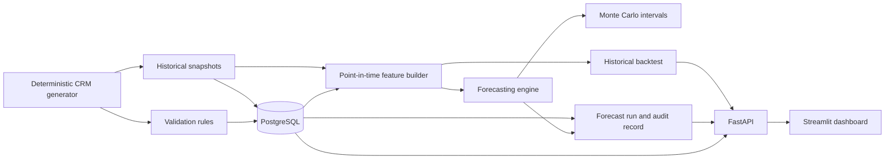
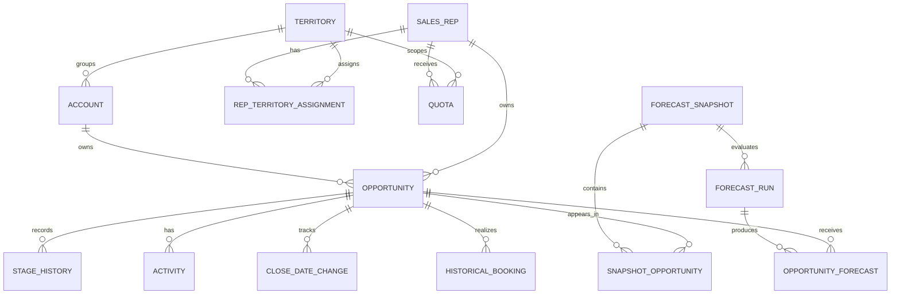

# Sales Forecasting & Pipeline Intelligence System

BUSS is a Python-based sales forecasting and pipeline intelligence platform. It uses deterministic synthetic CRM data, PostgreSQL, point-in-time feature generation, historical evaluation, scenario analysis, and a Streamlit interface to make forecast drivers and data-quality exceptions inspectable.

It is a self-contained research and demonstration implementation. Its records are synthetic, its forecasts are analytical estimates rather than guarantees, and it is not presented as a production CRM service.

## Overview

Sales leaders need a defensible view of expected bookings, quota coverage, pipeline risk, and the assumptions behind a forecast. BUSS models the workflow from CRM-shaped records through validation, effective-dated relationships, historical snapshots, forecast execution, and an auditable user interface.

The system keeps historical state separate from future outcomes so reported forecast experiments can be evaluated at a defined cutoff. Forecast inputs, outputs, and hashes are persisted to support deterministic reproduction.

## Key Features

### Data Engineering

- Deterministic synthetic CRM generator for sales representatives, accounts, territories, opportunities, activities, stage histories, quotas, assignments, bookings, and quarterly snapshots.
- PostgreSQL schema with primary keys, foreign keys, effective-date validation, lifecycle checks, and reconciliation-oriented entities.
- Bootstrap workflow that generates starter data, applies migrations, and idempotently seeds the database.
- Validation rules and exception records for contradictory lifecycle states, missing ownership, invalid dates, and reconciliation differences.

### Forecasting

- Point-in-time eligibility and feature construction that prevent use of outcomes known after the forecast cutoff.
- Expected-bookings calculation using amount, historical stage conversion, timing-to-horizon, and expected booking fraction.
- Opportunity age, stage duration, recent activity, and historical conversion features.
- Deterministic Monte Carlo forecast intervals: P10, P50, and P90.
- BASE, CONSERVATIVE, OPTIMISTIC, and CUSTOM scenarios with explicit conversion, timing, activity, and booking assumptions.

### Business Intelligence

- Executive quota and forecast context, pipeline exploration, risk and exception investigation, scenario comparison, model evaluation, and audit traceability.
- FastAPI endpoints for forecast execution, scenario analysis, historical evaluation, and supporting CRM views.
- Streamlit pages with filters, empty states, business-formatted values, and expandable technical evidence.

### Evaluation and Traceability

- Historical snapshot backtesting with point-in-time controls.
- Forecast-run persistence, model and feature hashes, fixed seeds, input/output hashes, and reproducibility checks.
- Controlled anomaly fixtures that distinguish detections from unaffected records.
- Full-scale deterministic generation and PostgreSQL loading evidence.

## Architecture

The generator creates consistent synthetic operational and historical records. PostgreSQL stores the relational source of truth; the feature builder reads only state available at each snapshot cutoff. Forecast runs and backtests persist their evidence, which the API and dashboard expose.

## Data Model

The sales-representative-to-territory relationship is effective dated through the assignment bridge. Snapshot opportunities preserve the observed state used for historical evaluation, while later bookings and outcomes remain separate from forecast inputs. See the [entity relationships](docs/entity_relationships.md), [schema reference](docs/schema.md), and [data dictionary](docs/data_dictionary.md) for implemented columns and constraints.

## Technology Stack

| Area | Technology |
|---|---|
| Application | Python 3.11 |
| API | FastAPI, Pydantic, Uvicorn |
| Data access | PostgreSQL 16, Psycopg 3 |
| Analytics | pandas, NumPy |
| Dashboard | Streamlit |
| Testing | pytest, HTTPX |
| Runtime | Docker, Docker Compose v2 |

## Getting Started

### Prerequisites

- Docker Desktop or a Docker Engine installation with Docker Compose v2.
- Git, if you are cloning the repository.

Run the following commands from the repository root in PowerShell:

    Copy-Item .env.example .env
    # Edit .env and set POSTGRES_PASSWORD to a local secret.
    docker compose up --build -d
    docker compose ps
    docker compose logs bootstrap

The bootstrap container completes three ordered actions:

1. Generates starter data in the dedicated runtime-data volume.
2. Applies PostgreSQL migrations.
3. Seeds generated records with database validation enabled.

A successful bootstrap service exits with code 0; API and dashboard services start after it completes.

### Default Local Endpoints

| Service | Published host address | Container port |
|---|---:|---:|
| PostgreSQL | localhost:5545 | 5432 |
| FastAPI | [http://localhost:8011](http://localhost:8011) | 8000 |
| OpenAPI docs | [http://localhost:8011/docs](http://localhost:8011/docs) | 8000 |
| Streamlit | [http://localhost:8511](http://localhost:8511) | 8501 |

The published host ports are for local access. Services communicate inside the Compose network on their container ports.

For a routine stop and restart that retains database and runtime-data volumes:

    docker compose stop
    docker compose up -d

Use docker compose logs -f bootstrap, docker compose logs -f api, and docker compose logs -f dashboard to investigate startup errors. Do not remove volumes when the intent is to retain local historical and forecast records.

## Synthetic Data

The generator supports a quick starter profile and a reproducible full profile.

| Profile | Sales representatives | Accounts | Opportunities | Historical snapshots | Seed |
|---|---:|---:|---:|---:|---:|
| Starter | 20 | 20 | 200 | Quarterly, 2025-01-01 through 2026-12-31 | 20261022 |
| Full | 2,000 | 2,000 | 20,000 | Eight quarterly periods | 20261022 |

Generate data outside the Compose bootstrap when needed:

    python -m src.generator --output runtime-data/starter
    python -m src.generator --scale full --seed 20261022 --output runtime-data/full

Generated datasets are excluded from version control. Controlled ground-truth fixtures used by tests are tracked under data/ground_truth/. Dataset definitions and reproducibility procedures are documented in [generator assumptions](docs/generator_assumptions.md) and [reproduction](docs/reproduction.md).

## Forecasting Method

For an eligible opportunity, expected recognized bookings are calculated as:

    reporting-currency amount
    × P(eventual win | snapshot stage)
    × P(recognized in horizon | expected close date, prior slippage)
    × expected booking fraction

Closed-won and closed-lost opportunities do not contribute future pipeline value. Stage-based conversion uses historical evidence available at the cutoff. Timing uses the expected close date and earlier close-date movement; a prior close-date change reduces timing probability, subject to a documented floor.

The point-in-time feature builder includes only observations available on or before the cutoff, including current stage and stage duration, opportunity age and expected days to close, trailing 30- and 90-day activities, historical conversion and win-rate aggregates, and effective sales-representative and territory assignments.

Monte Carlo execution samples joint win and recognition events with a fixed seed and aggregates a forecast distribution. The API reports P10, P50, and P90 values; they communicate simulated uncertainty under the model assumptions, not a confidence guarantee.

Scenarios alter documented conversion, timing, activity, and booking-fraction assumptions rather than applying an opaque multiplier. The [baseline method](docs/baseline_forecasting.md), [feature engineering](docs/feature_engineering.md), [uncertainty method](docs/uncertainty_forecasting.md), and [scenario definitions](docs/scenarios.md) describe the safeguards and equations.

## API and Dashboard

The FastAPI service exposes health, CRM views, forecasts, scenarios, historical evaluation, exceptions, and audit data. OpenAPI documentation is available at /docs.

| Dashboard page | Purpose |
|---|---|
| Executive Overview | Expected bookings, scoped quota, attainment, and uncertainty context |
| Pipeline Explorer | Opportunity, stage-history, and activity exploration |
| Risk and Exceptions | Data-quality categories, severity, impact, and investigation guidance |
| Scenario Planner | Side-by-side BASE, CONSERVATIVE, OPTIMISTIC, and CUSTOM outputs |
| Model Evaluation | Historical metrics, periods, and model limitations |
| Audit and Traceability | Snapshot, model, seed, hashes, and reproducibility evidence |

A local health check can be made after startup:

    Invoke-RestMethod http://localhost:8011/health

Endpoint contracts are summarized in [API documentation](docs/api.md); dashboard behavior is described in [Streamlit documentation](docs/streamlit_dashboard.md).

## Validation and Benchmarks

Full-scale validation used the deterministic full profile in an isolated PostgreSQL environment. The results below are engineering evidence for that environment, not capacity commitments for another machine or a production deployment.

- Two independent full generations with seed 20261022 produced matching logical checksums.
- The full dataset loaded approximately 300,391 rows in 33.439 seconds, or about 8,983 rows per second.
- The full forecast evaluated 938 eligible opportunities in 5.608 seconds.
- Expected bookings were $4,222,408.71; the opportunity-level expected-contribution sum matched with a difference of $0.00.
- Eight distinct quarterly snapshots were present.
- Five controlled anomaly types were detected with no false positives or false negatives in the recorded fixture run.
- Recorded source-suite validation reported 66 passed and 7 integration-only skips; a separate isolated PostgreSQL run reported 72 passed. Both runs recorded one third-party deprecation warning.

Detailed evidence is available in the [full-scale validation report](reports/full_scale_validation.md), [reproduction instructions](docs/reproduction.md), and [anomaly injection documentation](docs/anomaly_injection.md).

## Testing

Run the default automated suite from a Python environment with the project dependencies installed:

    python -m pytest -q

Database integration tests require an explicitly configured disposable test database. Keep that target separate from an active working database and use a name ending in _test. The suite covers generator determinism, validation rules, API contracts, scenario calculations, point-in-time boundaries, reconciliation, and dashboard-facing calculations.

For repeatable full-scale evidence, generate the full profile with the fixed seed, load it into an isolated PostgreSQL instance, and compare logical checksums and reconciliations using the procedures in [reproduction](docs/reproduction.md). The default workflow does not require destructive database operations.

## Documentation

- [API reference](docs/api.md)
- [Data dictionary](docs/data_dictionary.md)
- [Database schema](docs/schema.md)
- [Entity relationships](docs/entity_relationships.md)
- [Feature engineering](docs/feature_engineering.md)
- [Forecasting method](docs/baseline_forecasting.md)
- [Scenario definitions](docs/scenarios.md)
- [Database operations](docs/database.md)
- [Deployment](docs/deployment.md)
- [Reproduction](docs/reproduction.md)
- [Known limitations](docs/limitations.md)

## Limitations

- All CRM records, historical outcomes, and anomaly cases are synthetic; conclusions do not describe a real sales organization.
- Historical coverage is finite and intentionally constructed, so model behavior should not be generalized to live CRM data without independent validation.
- Point-in-time safeguards reduce leakage in the implemented experiments, but they do not turn synthetic history into evidence of real-world predictive performance.
- The application has no production authentication, authorization, secrets management, monitoring, high availability, or backup design.
- Forecast intervals quantify variation under specified assumptions; they do not capture every operational, economic, or data-collection uncertainty.
- The service is intended for local, reproducible analysis rather than multi-user operational use.

## Future Improvements

- Connect a governed production CRM source with documented snapshot retention.
- Add role-based access control, managed secrets, observability, backup, and recovery procedures.
- Evaluate models on independently collected historical data with formal monitoring for drift and calibration.
- Add stronger workload, concurrency, and operational resilience testing.
- Extend scenario review with approval workflows and stored business assumptions.
