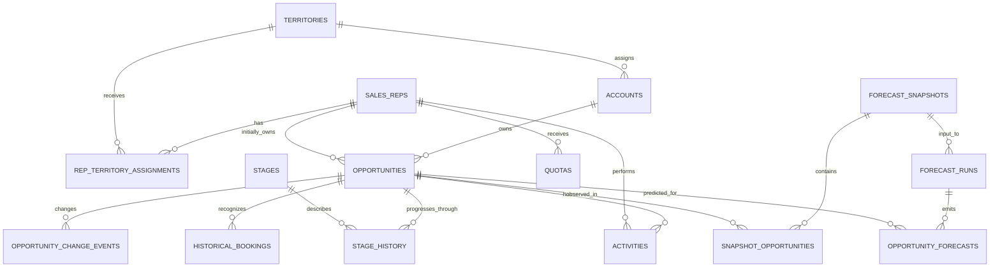

# Relationships and referential behavior

## Cardinality and referential behavior

| Parent → child | Cardinality | Delete / update behavior |
|---|---|---|
| Territory → Account | 1 : many | `RESTRICT`; territory identity never cascades |
| SalesRep ↔ Territory | many : many over time | `rep_territory_assignments` bridge; per-rep effective periods cannot overlap |
| Account → Opportunity | 1 : many | `RESTRICT` |
| SalesRep → Opportunity | 1 : many | `RESTRICT`; initial ownership remains historical |
| Opportunity → StageHistory / changes / activities | 1 : many | `RESTRICT`; child events append only |
| SalesRep → Quota | 1 : many | `RESTRICT`; one quota per fiscal quarter |
| Opportunity → HistoricalBooking | 1 : many | `RESTRICT`; permits auditable adjustments and reversals |
| Snapshot ↔ Opportunity | many : many | `snapshot_opportunities` bridge; one row per pair |
| Snapshot → ForecastRun → OpportunityForecast | 1 : many : many | `RESTRICT`; preserves reproducibility |

No business entity uses cascade delete. Corrective data is represented as a new event, an adjustment/reversal booking, or a data-quality finding. Business IDs are immutable; therefore `ON UPDATE` takes PostgreSQL's default `NO ACTION`.

## Lifecycle validation at ingestion

1. The first stage event of each lifecycle has `from_stage IS NULL` and sequence 1.
2. Ordinary transitions advance stage rank; a transition into either closed stage ends that lifecycle.
3. A Closed Lost reopen must have reason `REOPENED`, start the next lifecycle, and return to a non-terminal stage.
4. Closed Won requires a matching booking; once a booking exists, reopening is invalid.
5. Activities and all events must be timestamped on/after opportunity creation.
6. A booking's transaction currency must equal the effective opportunity currency at recognition time; its amount must reconcile to the effective final amount after adjustments.

These rules are intentionally validation-service checks because they need ordered access to multiple event rows. Structural FK, uniqueness, value, and temporal non-overlap guarantees are enforced directly in SQL.
